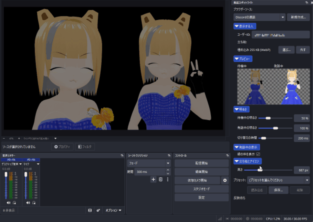

# 発話スポットライト / Speaker Spotlight

OBS Studio のブラウザーソースに表示した Discord StreamKit Overlay の音声ウィジェットで、話している人を明るく、話していない人を暗く表示するプラグインです。Discord のアバターを、ご自分の立ち絵に置き換えられます。CSS を書かずに、ドックの設定だけで使えます。

A plugin for OBS Studio that highlights the person speaking in the Discord StreamKit Overlay voice widget shown in a browser source, dims the others, and replaces the Discord avatar with your own character portrait, all from a dock and without writing CSS.

[配信プラグイン倉庫くん](https://soko-kun.allegromoltov.jp/plugins/allegromoltov/obs-speaker-spotlight) にも掲載しています。 / Also listed on [Plugin Soko-kun](https://soko-kun.allegromoltov.jp/plugins/allegromoltov/obs-speaker-spotlight?lang=en).



本プラグインは Discord とは提携しておらず、Discord の承認を受けたものではありません。

This plugin is not affiliated with, endorsed by, or sponsored by Discord.

## Features / 機能

ブラウザーソース 1 つに、Discord の参加者 1 人を表示します。人数分のブラウザーソースを作り、OBS のシーンで好きな位置に置いて使います。

- 表示する人: Discord のユーザー ID で指定します。ほかの参加者と名前は表示しません
- 立ち絵: png か jpg の画像を選ぶと、Discord のアバターの代わりに表示します。立ち絵を選ばないときは、Discord のアバターのまま表示します
- 明るさ: 待機中の明るさ、発話中の明るさ、切り替えにかける時間
- 発話中の表示: Discord の既定の緑の枠の表示の有無。緑の枠はアバターのときだけ表示し、立ち絵には表示しません
- 立ち絵とアイコン: 表示の高さ。20px から 2160px まで
- プレビュー: ドックの中で、待機中と発話中の見た目を並べて確かめられます
- プリセット: 見た目の設定に名前を付けて保存し、ほかのブラウザーソースへ読み込めます。ユーザー ID と立ち絵はプリセットに含めません

設定を変えると、ドックのプレビューにはすぐに反映されます。ブラウザーソースへは、最後の操作から約 2 秒後に自動で反映します。ブラウザーソースの幅と高さは、立ち絵 (またはアバター) の大きさに自動で合わせます。

立ち絵は、選んだ時点で高さ 2160px 以下に縮小し、WebP の形式でブラウザーソースの設定に保存します。保存した後は、元の画像のファイルを読みません。元の画像を移動・削除しても表示は変わりません。選べる画像は 50 MB 以下、1 億画素以下です。

ブラウザーソースのカスタム CSS のうち、本プラグインが書き換えるのは `/* speaker-spotlight begin */` から `/* speaker-spotlight end */` までの範囲だけです。範囲の外に書いた CSS はそのまま残ります。このほかに、ブラウザーソースの幅と高さを書き換えます。

本プラグインは外部と通信しません。StreamKit のページを読み込み、Discord と通信するのは、OBS Studio に標準で入っているブラウザーソースです。立ち絵の画像は CSS の中に埋め込むため、生成する CSS は外部の資源を読み込む `@import` や `url()` を含みません。

## Installation / インストール

### Windows

OBS Studio 33.0.1 以降に対応しています。

1. OBS Studio を終了してください。
2. [Releases](../../releases) から Windows 用の ZIP ファイルをダウンロードし、展開してください。
3. エクスプローラーのアドレスバーへ `%PROGRAMDATA%` を入力し、Enter キーを押してください。
4. `obs-studio` フォルダーを開き、その中の `plugins` フォルダーを開いてください。存在しないフォルダーは順に作成してください。
5. 展開した `speaker-spotlight` フォルダーを `plugins` へコピーしてください。管理者の許可を求められた場合は許可してください。
6. OBS Studio を起動し、メニューの「ドック」から「発話スポットライト」を選んでください。

導入後の構成は次のとおりです。`speaker-spotlight` フォルダーを二重に作らないでください。

```text
%PROGRAMDATA%\obs-studio\plugins\
└─ speaker-spotlight\
   ├─ speaker-spotlight.dll
   └─ data\
      └─ locale\
         ├─ en-US.ini
         └─ ja-JP.ini
```

ポータブル版の OBS Studio では、OBS Studio のフォルダーの `bin` や `data` と同じ階層に `plugins` フォルダーを作成し、`speaker-spotlight` フォルダーをコピーしてください。

### macOS / Linux

ビルド済みのファイルは配布していません。後述の「ビルド」にしたがい、公開タグのソースからビルドしてください。macOS と Linux のビルドは GitHub Actions で確かめていますが、作者は実機での動作を確かめていません。

## Usage / 使い方

使う前に、Discord のデスクトップアプリを起動し、音声チャンネルに入ってください。StreamKit の音声ウィジェットは、同じ PC で動いている Discord のデスクトップアプリから参加者の情報を受け取ります。

1. StreamKit の音声ウィジェットの URL を用意します。https://streamkit.discord.com/overlay で「Install for OBS」を選び、「VOICE WIDGET」でサーバーと音声チャンネルを選ぶと、URL が表示されます。
2. ドックの「新規作成…」で URL を貼り付け、ブラウザーソースを作ります。2 人目からは、選んでいるブラウザーソースの URL が最初から入っています。
3. ドックの「表示する人」に、表示したい人の Discord のユーザー ID を入力します。
4. 立ち絵を使う場合は、「選ぶ…」で画像を選びます。「外す」を押すと、Discord のアバターの表示に戻ります。
5. 明るさと大きさを、プレビューを見ながら調整します。
6. OBS のシーンで、ブラウザーソースを好きな位置に動かします。
7. 人数分、2 から 6 を繰り返します。同じ見た目にしたいときは、プリセットに保存して読み込んでください。

### ユーザー ID の調べ方

Discord の「ユーザー設定」の「詳細設定」で「開発者モード」を有効にします。参加者を右クリックし、「ユーザーIDをコピー」を選ぶと、ユーザー ID をコピーできます。

### 名前を表示したいとき

本プラグインは名前を表示しません。名前を出したいときは、OBS Studio のテキストソースを立ち絵の近くに置いてください。書体、縁取り、影なども、テキストソースで自由に設定できます。

### 立ち絵の画像について

立ち絵には、ご自分が権利を持つ画像、または配信での利用が許されている画像を使ってください。

### 規約について

Discord の利用規約は、サービスの改変などについて定めています。本プラグインで StreamKit の表示を変えることについて、規約に照らした可否の判断は、利用者の責任で行ってください。

設定はブラウザーソースごとにシーンコレクションへ保存され、OBS Studio を起動し直しても残ります。

## Parameters / パラメータ

| Parameter | 日本語 | Range | Default |
|-----------|--------|-------|---------|
| Idle brightness | 待機中の明るさ | 0 ~ 200 % | 50 % |
| Speaking brightness | 発話中の明るさ | 0 ~ 200 % | 100 % |
| Transition | 切り替えの時間 | 0 ~ 2000 ms | 200 ms |
| Speaking border | 緑の枠を表示 | オン / オフ | オン |
| Height | 高さ | 20 ~ 2160 px | 150 px |

## Known Behavior / 既知の挙動

- 設定がブラウザーソースに反映されるたびに、ブラウザーソースは StreamKit のページを読み込み直します。そのとき、表示が約 1 秒途切れます。配信中に設定を変える場合は、この挙動に注意してください。ブラウザーソースの幅と高さだけが変わるときは、読み込み直しません。
- 表示する人が音声チャンネルにいないときは、何も表示されません。
- ブラウザーソースの大きさを手で変えても、次に設定を反映したときに、立ち絵 (またはアバター) の大きさに戻ります。シーンでの大きさは、OBS のシーンのアイテムの拡大・縮小で変えてください。
- OBS Studio を起動し直すと、ドックで選んでいたブラウザーソースの選択は空に戻ります。設定は保存されています。
- 立ち絵は 1 つのブラウザーソースにつき数百 KB をシーンコレクションのファイルに保存し、同じ大きさの CSS をカスタム CSS に書き込みます。
- Discord StreamKit Overlay のページの作りが変わると、動かなくなることがあります。

## Build / ビルド

### Requirements / 必要環境

| Platform | Tool |
|----------|------|
| Windows | Visual Studio 17 2022, CMake 3.28+ |
| macOS | Xcode 16.0, CMake 3.28+ |
| Ubuntu 24.04 | ninja-build, pkg-config, build-essential, CMake 3.28+ |

### Build Commands / ビルドコマンド

```bash
# Windows
cmake --preset windows-x64 -DENABLE_POST_BUILD_INSTALL=OFF
cmake --build build_x64 --config RelWithDebInfo

# macOS
cmake --preset macos
cmake --build build_macos --config RelWithDebInfo

# Ubuntu
cmake --preset ubuntu-x86_64
cmake --build build_x86_64 --config RelWithDebInfo
```

Windows で生成物を取り出すには、`cmake --install build_x64 --config RelWithDebInfo --prefix release/RelWithDebInfo` を実行してください。生成した `speaker-spotlight` フォルダーを前述の手順で導入してください。

## AI利用開示 / AI Disclosure

### 日本語

v1.0.0 までの制作では、Anthropic Claude Code を、調査、ソースコード、ビルド設定、テスト、文書、ロゴを含むほぼすべての工程で使用しました。

作者本人は Windows の OBS Studio でユーザーテストを実施しました。コード読解による厳密な人間レビューは実施していません。ロゴは Claude Code が出力した SVG の案から作者が選んだものです。説明の画像のアニメーション GIF は、作者本人が ScreenToGif で画面収録したもので、生成 AI を使用していません。

### English

Anthropic Claude Code was used for almost the entire development process up to v1.0.0, including research, source code, build configuration, tests, documentation, and the logo.

The author performed user testing in OBS Studio on Windows but did not perform a rigorous human review of the source code. The logo was chosen by the author from SVG proposals generated by Claude Code. The animated GIF in the description was screen-recorded by the author using ScreenToGif, without generative AI.

## License / ライセンス

GPL-2.0 License (same as OBS Studio)

このプラグインは [obs-plugintemplate](https://github.com/obsproject/obs-plugintemplate) をベースにしています。

## Author / 作者

AllegroMoltoV - https://www.allegromoltov.jp

## Changelog / 更新情報

### v1.0.1

- リリースの配布物にビルドの来歴の証明 (GitHub Artifact Attestation) を付けるようにしました。プラグインの動作は v1.0.0 と同じです。

### v1.0.0

- 最初の公開版です。
